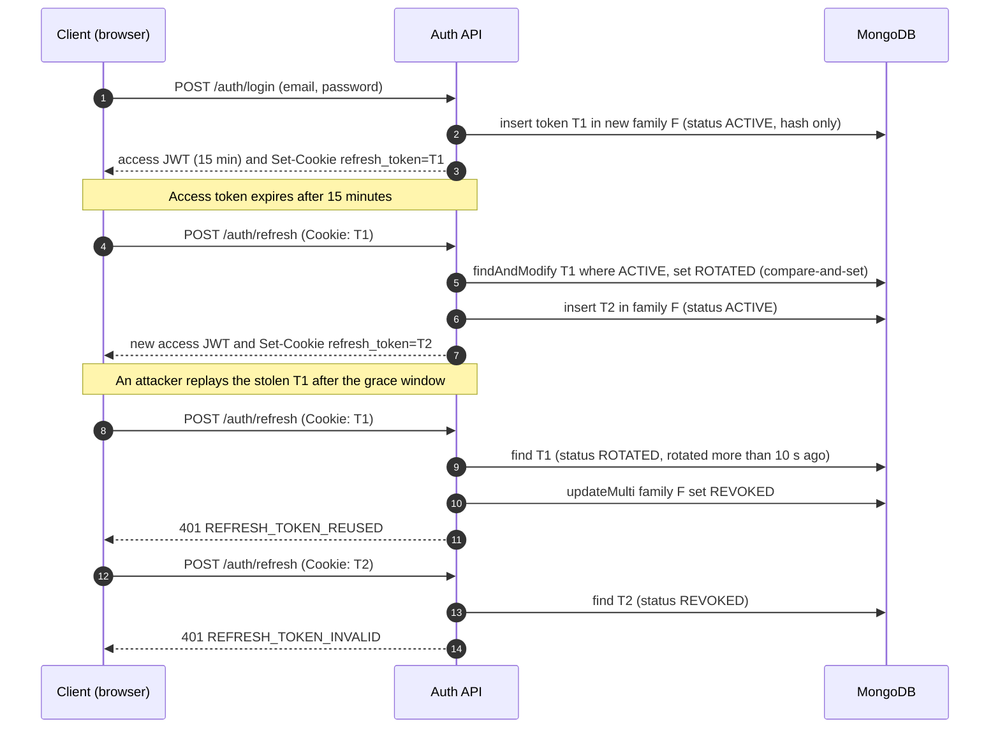

# secure-auth-service

[](https://github.com/Riya-086/secure-auth-service/actions/workflows/ci.yml)

A Spring Boot authentication service that shows how to issue long-lived sessions safely. It uses single-use refresh-token rotation, detects replayed tokens, and revokes the session when a replay happens.

## The problem

Short-lived access tokens expire quickly, so a session needs a longer-lived credential to renew them. That credential is the attractive target. If a refresh token is stolen and can be used forever, the attacker keeps the account even after the victim changes their password.

This service addresses that in four ways:

1. **Rotation.** Each refresh token works exactly once. Using it returns a successor and retires the old one.
2. **Atomic rotation.** Two requests that race on the same token cannot both succeed.
3. **Replay detection.** Presenting a token that was already rotated, after a short grace period, is treated as theft. The whole session is revoked.
4. **Hashed storage.** The database holds only SHA-256 hashes, so a database leak does not yield usable tokens.

## How a session flows



Within the 10-second grace window, a retry of an already-rotated token is a concurrent request rather than theft. For example, a second browser tab still holds the old cookie. The service returns a new access token and no cookie, because the browser already holds the successor from the first response.

## Design decisions

### Why compare-and-set

A naive rotation reads the token, checks that it is `ACTIVE`, and then writes `ROTATED`. Two requests can both pass the check before either writes, so both succeed and one token forks into two sessions.

`RefreshTokenStore.claimActive` runs a single `findAndModify` whose filter is `{tokenHash, status: ACTIVE, sessionExpiresAt > now}` and whose update sets `status: ROTATED`. MongoDB applies the filter and the update atomically on one document, so exactly one caller gets the document back. The integration test `parallelRefreshesOfOneTokenRotateExactlyOnce` sends ten simultaneous refreshes and asserts there is one successor.

### Why hashed tokens

A refresh token is 256 bits of randomness from `SecureRandom`, encoded as base64url. The database stores `SHA-256(token)` in a unique index. Two properties follow:

- A database dump contains nothing that can be presented as a cookie.
- SHA-256 without a salt or a slow hash is acceptable here. Slow hashes such as BCrypt exist to resist guessing low-entropy passwords. A 256-bit random value cannot be guessed, so a fast hash is enough.

### Why the grace window

Without a grace window, two legitimate requests that race (two tabs, or a client retry after a timeout) look exactly like theft. The second one would revoke the user's session.

The window is 10 seconds. Inside it, a reused token gets a fresh access token and no new cookie. After it, reuse is treated as a replay. The trade-off: an attacker who holds a token that was just rotated can use it for up to 10 seconds. The response gives them one access token (15 minutes) and no refresh token, so they cannot extend the session on their own. The service cannot return the successor's refresh token here because it stores only hashes. The cookie in the victim's browser already holds the successor.

### Why token families

Every token issued during one login shares a `familyId`, and each successor copies the family's absolute `sessionExpiresAt`. This gives two properties:

- **Replay revokes the right thing.** When an old token is replayed, the service revokes that family, which includes the attacker's successor and the legitimate user's current token. Other logins for the same user, such as a phone or a second laptop, are unaffected.
- **Rotation cannot extend a session.** A session ends 30 days after login no matter how many times it rotates.

## Running it

Requirements: Docker. Java 21 and Maven 3.9 are needed only to build or test outside Docker.

```bash
# Optional: set your own signing key (32+ characters). A dev default is used otherwise.
export JWT_SECRET='replace-with-a-long-random-string-of-32-plus-chars'

docker compose up --build
```

The API listens on `http://localhost:8080`. MongoDB is reachable only from the app container.

## Running the tests

Integration tests use Testcontainers, so Docker must be running.

```bash
mvn verify   # unit tests (surefire) and integration tests (failsafe)
mvn test     # unit tests only
```

| Test | What it proves |
| --- | --- |
| `RefreshTokenStoreIT` | 32 concurrent claims of one token produce exactly one winner; family revocation is scoped to one family |
| `RefreshRotationIT` | Rotation sets a successor cookie; 10 parallel refreshes produce exactly one rotation |
| `ReplayDetectionIT` | Replay after the grace window revokes the family and leaves other sessions alone |
| `GraceWindowIT` | A retry inside the window gets an access token and no cookie; the boundary is inclusive at 10 s |
| `RateLimitIT` / `RateLimitPerIpIT` | Per-user and per-IP buckets return 429 with `Retry-After`; a rejected request does not rotate the token |
| `LogoutIT` | Logout revokes the family and clears the cookie |
| `AuthFlowIT` | Registration, login, cookie flags, `/me`, validation, and error shapes |

CI runs `mvn verify` on every push and pull request, using [`.github/workflows/ci.yml`](.github/workflows/ci.yml).

## API

Errors share one shape: `{"code": "...", "message": "..."}`. Clients should branch on `code`.

| Method and path | Auth | Success | Notes |
| --- | --- | --- | --- |
| `POST /auth/register` | none | `201` user | Email is normalised to lowercase |
| `POST /auth/login` | none | `200` tokens | Sets the refresh cookie and starts a new family |
| `POST /auth/refresh` | refresh cookie | `200` tokens | Rotates the token; `429` when rate-limited |
| `POST /auth/logout` | refresh cookie | `204` | Revokes the family and clears the cookie |
| `GET /me` | `Authorization: Bearer <accessToken>` | `200` user | Requires a valid, unexpired access token |

The refresh cookie is `HttpOnly; Secure; SameSite=Strict; Path=/auth`. The access token is returned in the body and expires after 15 minutes.

### Examples

Register:

```bash
curl -s -X POST localhost:8080/auth/register \
  -H 'Content-Type: application/json' \
  -d '{"email":"you@example.com","password":"a-long-passphrase"}'
```

Login. The access token is in the body. The refresh token is in the `Set-Cookie` header; copy its value for the next calls.

```bash
curl -s -i -X POST localhost:8080/auth/login \
  -H 'Content-Type: application/json' \
  -d '{"email":"you@example.com","password":"a-long-passphrase"}'
```

Refresh. Send the cookie value from login. The response carries a new `Set-Cookie`, and the old value stops working.

```bash
curl -s -i -X POST localhost:8080/auth/refresh \
  -H 'Cookie: refresh_token=<value from login>'
```

Call `/me` with the access token:

```bash
curl -s localhost:8080/me \
  -H 'Authorization: Bearer <accessToken>'
```

Logout:

```bash
curl -s -i -X POST localhost:8080/auth/logout \
  -H 'Cookie: refresh_token=<current value>'
```

### Error codes

| Code | HTTP | Meaning |
| --- | --- | --- |
| `VALIDATION_FAILED` | 400 | A field failed Bean Validation; `message` lists the fields |
| `MALFORMED_REQUEST` | 400 | The JSON body is missing or unreadable |
| `INVALID_CREDENTIALS` | 401 | Wrong email or password (the two cases are indistinguishable) |
| `UNAUTHORIZED` | 401 | Missing or invalid access token |
| `REFRESH_TOKEN_MISSING` | 401 | No refresh cookie was sent |
| `REFRESH_TOKEN_INVALID` | 401 | Unknown, expired, or revoked refresh token |
| `REFRESH_TOKEN_REUSED` | 401 | A rotated token was replayed after the grace window; the family was revoked |
| `EMAIL_ALREADY_REGISTERED` | 409 | The email is taken |
| `RATE_LIMITED` | 429 | Over the per-user or per-IP limit; see `Retry-After` |

## Configuration

Settings live in [`application.yml`](src/main/resources/application.yml) under `auth.*`.

| Property | Default | Meaning |
| --- | --- | --- |
| `auth.jwt.secret` | from `JWT_SECRET` | HMAC-SHA256 key. Startup fails without it. |
| `auth.jwt.access-token-ttl` | `15m` | Access-token lifetime |
| `auth.refresh.session-ttl` | `30d` | Absolute session lifetime; rotation never extends it |
| `auth.refresh.grace-window` | `10s` | Retry window before a reused token counts as a replay |
| `auth.rate-limit.refresh-per-user` | 5 burst, 5 per minute | Per-user bucket on `/auth/refresh` |
| `auth.rate-limit.refresh-per-ip` | 30 burst, 30 per minute | Per-IP bucket on `/auth/refresh` |

## Known limitations

- **Rate limits are per process.** The buckets are in-memory, so each instance enforces its own limits. A shared store such as Redis is needed for a multi-instance deployment.
- **Client IP comes from the socket.** `X-Forwarded-For` is not trusted. Behind a load balancer, every client would share the balancer's IP, so the per-IP limit needs a trusted proxy configuration.
- **A crash between rotation and insert ends the session.** The old token is marked rotated before the successor is written. The user then logs in again. Writing both in one transaction would close this gap.
- **CSRF protection is by cookie policy.** CSRF is disabled because the refresh cookie is `SameSite=Strict`. Cross-site form posts therefore cannot carry it.
- **No password reset, email verification, or account lockout.** These are outside the scope of the rotation design.

## Project layout

```
src/main/java/com/riyarakholiya/authservice/
  auth/        login, register, refresh, logout, token store, JWT issuing
  config/      properties, security filter chain, JWT beans, rate-limit beans
  ratelimit/   in-memory token buckets
  user/        user document and repository
  web/         error codes, JSON error shape, exception handling
src/test/java/...   unit tests (*Test) and Testcontainers integration tests (*IT)
```

## License

MIT. See [LICENSE](LICENSE).
